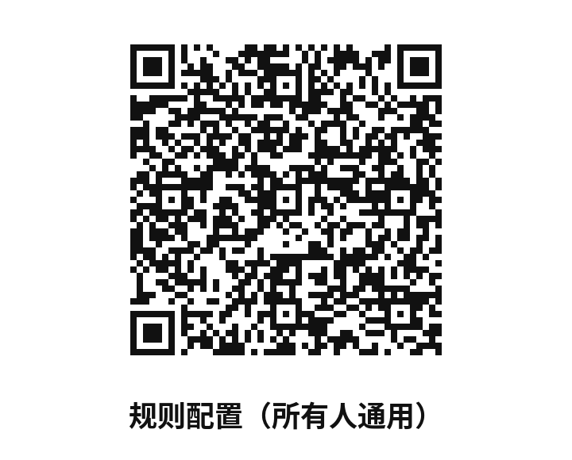

# 在 iPhone 上使用 Shadowrocket

请先在 App Store 安装 Shadowrocket（开发者 Shadow Launch Technology Limited）。  
再用 Kenny 私下发给你的**专属合并二维码**。不要用同事的码。

通用规则文件不含节点密钥，所有人共用；节点必须用你自己的码。

规则文件地址（无凭据，国内可不走代理访问）：

https://cdn.jsdelivr.net/gh/ikennychoi/company-shadowrocket-rules@main/company-vpn-shadowrocket-rules.conf

也可以直接扫描下面这张通用规则二维码（与合并图右侧相同）：

## 推荐做法：扫描合并图

1. 打开 Shadowrocket。在首页扫描合并图**左侧**「① 节点（仅本人）」，添加节点。不要删除旧节点。
2. 再扫描**右侧**「② 规则配置（所有人通用）」。若用系统相机扫描，选择「在 Shadowrocket 中打开」。
3. 到 Shadowrocket 的「配置」页面，点刚刚下载的配置，选择「使用配置」。
4. 回到首页，选中第 1 步添加的节点，打开连接。全局路由请使用「配置」。

## 备用做法：粘贴规则地址

如果规则二维码没有自动导入：

1. 确认节点已经用左侧二维码加好。
2. 打开「配置」，点右上角「+」。
3. 粘贴上面的 https 地址，选择「下载」。
4. 点刚下载的配置，选择「使用配置」。
5. 回到首页，选中自己的节点并连接。

## 确认已经走通

- 能打开 Google 等国外网站。
- 百度等国内网站仍然正常。
- 用 ippure.com 查 IP，应显示国外出口，而不是深圳等真实城市。国内查 IP 网站若未走代理，会显示真实位置，这是国内直连，不必惊慌。

连不上时，请确认：节点已选中、配置已「使用」、全局路由是「配置」、系统时间自动同步，且没有和其他 VPN 同时开启。
